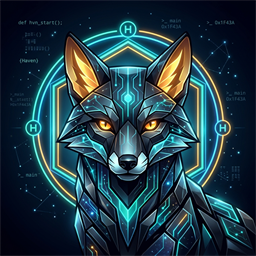

# 🦊 Haven Programming Language (ODCS Native Edition) - VS Code Extension

<p align="center">
  
</p>

<p align="center">
  <strong>Guarded by Haven Fox · Sovereign Digital Continuity · Zero Intent Loss</strong>
</p>

Official Visual Studio Code extension for the **Haven Programming Language** (`.hvn`, `.haven`) and the **Open Digital Continuity Standard (ODCS)** / **Open Financial Continuity Standard (OFCS)**.

Standard Architecture & Specification by **Anirudha Puthraya**.  
Maintained by the Haven Language Foundation.

---

## 🦊 The Haven Fox Mascot

Meet **Haven Fox** — the official celestial guardian of Haven Language:
- **Agility & Disruption Tolerance**: Swift, resilient execution that effortlessly bridges online and airgap offline modes.
- **Cryptographic Vigilance**: Guarding append-only Merkle ledgers and ensuring Zero Intent Loss (sub-16ms receipt minting).
- **Mathematical Exactness**: Enforcing Invariant 1 (Debits == Credits) with zero floating-point drift.

---

## Features

- 🦊 **Haven Fox Branding**: High-resolution icons, mascot theme, and status-bar indicator.
- 🌈 **Syntax Highlighting**: Full grammar definitions for Haven natural English keywords, ODCS durable constructs, OFCS monetary records, pipeline operators (`|>`), and enterprise annotations.
- ⚡ **Dynamic Autocomplete & Type Suggestions**: Context-aware completion items for all keywords, classes, methods, and decorators.
- 🏷️ **Intelligent Type Suggestions**: Context-driven type hints triggered upon typing `:`, `->`, or `[` for Primitives, Generics, ODCS Merkle types, OFCS Money, and Java Concurrency types.
- 📝 **Intelligent Signature Help**: Instant parameter tooltips and 59+ type contracts triggered upon typing `(`.
- 📐 **Keyword Uses & Hover Docs**: Comprehensive markdown documentation tooltips for every keyword.
- 🧪 **1-Click Test Runner & Microservice Launcher**: Run tests (`haven.test`) and launch backend microservices directly from the editor.
- 🛡️ **ODCS Invariant Security**: Native highlighting for `@Transactional`, `@Audit`, `checkpoint`, `preserve`, and `durable record`.

---

## 🏷️ Type Suggestions & Static Verification

Haven Language extension provides full context-aware type hints that appear at the top of the autocompletion menu when typing colons (`:`), return arrows (`->`), generic brackets (`[`), or defining fields inside `durable record`:

```haven
durable record PatientVitals:
    patient_id: str
    heart_rate: int
    blood_pressure: str
    recorded_at: int
    is_critical: bool

define transfer_funds(
    sender: FinancialAccount,
    recipient: FinancialAccount,
    amount: Money
) -> DoubleEntryRecord:
    ensure amount.is_positive() otherwise "Invalid transfer amount"
    give back DoubleEntryRecord(
        tx_id=uuid7(),
        debits=[amount],
        credits=[amount],
        description="P2P Transfer"
    )
```

### Type Suggestions Matrix

| Category | Available Types & Suggestions |
| :--- | :--- |
| **Primitives** | `str`, `int`, `float`, `bool`, `bytes`, `bytearray`, `list`, `dict`, `set`, `tuple`, `Decimal`, `object`, `None` |
| **Generics** | `Any`, `Optional[T]`, `Union[T1, T2]`, `List[T]`, `Dict[K, V]`, `Set[T]`, `Tuple[T, ...]`, `Callable[[Args], Ret]`, `Type[T]`, `Iterable[T]` |
| **ODCS Continuity** | `DurableRecord`, `ContinuityLedger`, `LedgerEntry`, `MerkleTree`, `VectorClock`, `LWWRegister`, `PNCounter`, `AWORSet`, `OutboxPipeline`, `MeshNode`, `GossipMesh`, `ContinuityMode`, `EnvironmentalTelemetry`, `IntentReceipt`, `ZeroIntentLossManager` |
| **OFCS Financial** | `Money`, `Currency`, `ExchangeRate`, `DoubleEntryRecord`, `FinancialAccount`, `OFCSFinancialLedger`, `ReconciliationEngine`, `ReconciliationReport` |
| **Java Enterprise** | `Interface`, `SealedClass`, `HavenEnum`, `Record`, `TypeBound`, `GenericContainer`, `CompletableFuture`, `AtomicInteger`, `AtomicBoolean`, `AtomicReference`, `CountDownLatch`, `ReentrantLock`, `VirtualExecutor` |
| **Backend Framework** | `HavenApp`, `HavenServer`, `Router`, `Request`, `Response`, `CORSMiddleware`, `ContinuityAuditMiddleware`, `RateLimiterMiddleware` |

---

## Keyword Uses & Reference

### 1. Variables & State Mutability

| Keyword Syntax | Description & Use |
| :--- | :--- |
| `set <var> to <val>` | Sets or reassigns mutable state in natural English. |
| `let <var> be <val>` | Introduces local variable bindings. |
| `remember <NAME> as <val>` | Declares an immutable constant value. |
| `increase <var> by <delta>` | Increases numeric variable by `<delta>`. |
| `decrease <var> by <delta>` | Decreases numeric variable by `<delta>`. |

### 2. Conditionals & Control Flow

| Keyword Syntax | Description & Use |
| :--- | :--- |
| `whenever <cond>:` | Evaluates block when `<cond>` is truthy. |
| `otherwise if <cond>:` | Alternative conditional branch. |
| `otherwise:` | Default fallback branch when prior conditions are false. |
| `unless <cond>:` | Inverted conditional; executes when `<cond>` is false. |
| `ensure <cond> otherwise "<msg>"` | Asserts invariant condition; raises error with `<msg>` on failure. |

### 3. Loops & Iteration

| Keyword Syntax | Description & Use |
| :--- | :--- |
| `repeat <N> times:` | Ergonomic loop executed exactly `<N>` iterations. |
| `for each <item> in <coll>:` | Natural iteration through collections and iterables. |
| `until <cond>:` | Loops until `<cond>` becomes true. |
| `forever:` | Infinite execution loop with sub-millisecond dispatch. |
| `stop` / `skip` | Loop control statements equivalent to break / continue. |

### 4. Functions & Pipeline

| Keyword Syntax | Description & Use |
| :--- | :--- |
| `function <name>(args):` / `to <name>(args):` | Subroutine and function definitions. |
| `give back <expr>` | Returns a computed value from a function. |
| `<val> \|> <func1> \|> <func2>` | Unix-style functional data pipeline with placeholder `_` support. |

### 5. Error Recovery

| Keyword Syntax | Description & Use |
| :--- | :--- |
| `try:` | Protected execution block. |
| `recover as <err>:` | Catches and inspects exceptions without unhandled termination. |
| `always:` | Cleanup block guaranteed to execute regardless of errors. |

### 6. ODCS Continuity & Immutability

| Keyword Syntax | Description & Use |
| :--- | :--- |
| `durable record <Name>:` | Creates an immutable, cryptographically sealed ODCS record. |
| `checkpoint <asset> as "<alias>" into <ledger>` | Commits state snapshot into append-only Merkle ledger. |
| `preserve <payload> as "<alias>" into <ledger>` | Seals operational intent receipts into durable storage. |
| `verify <asset> with <proof>` | Validates cryptographic SHA-256 Merkle proofs. |

---

## Enterprise Backend Microservices

Haven includes a high-performance, multi-threaded microservice framework:

```haven
from haven import HavenApp, Request, Response

app = HavenApp(name="PaymentGateway", port=8080, cors=True, continuity_audit=True)

@app.get("/api/v1/health")
def health(req: Request) -> Response:
    return Response.ok("Payment Gateway is healthy")

@app.get("/api/v1/accounts/{account_id}/balance")
def get_balance(req: Request) -> Response:
    account_id = req.path_params.get("account_id")
    return Response.json({"account": account_id, "status": "ACTIVE"})

@app.post("/api/v1/orders")
def create_order(req: Request) -> Response:
    order_data = req.json
    return Response.json({"order_id": "ORD-101", "data": order_data}, status_code=201)

if __name__ == "__main__":
    app.run(blocking=True)
```

### Pre-Built ODCS & OFCS REST Endpoints
Every Haven server automatically provides cryptographic audit endpoints:
- `GET /odcs/health` - Ledger height, head hash, and integrity verification.
- `GET /odcs/ledger/blocks?limit=20` - Paginated tamper-evident blocks.
- `GET /ofcs/accounts` - Registered double-entry financial accounts and exact decimal balances.

---

## Open Financial Continuity Standard (OFCS)

Eliminates IEEE-754 floating-point drift and enforces double-entry balance:

```haven
from ofcs import DoubleEntryRecord, Money, USD, OFCSFinancialLedger

ledger = OFCSFinancialLedger(ledger_name="vault")
acc_source = ledger.create_account("ACC-101", USD, initial_balance="1000.00")
acc_dest = ledger.create_account("ACC-102", USD, initial_balance="0.00")

# Invariant 1: Sum(Debits) MUST EQUAL Sum(Credits)
tx = DoubleEntryRecord(
    tx_id="TX-5001",
    debits=[Money("250.00", USD)],
    credits=[Money("250.00", USD)],
    description="Transfer"
)
entry = ledger.post_transaction(tx)
```

---

## Enterprise Concurrency & Annotations

- **CompletableFuture**: Reactive non-blocking concurrency:
  ```haven
  from haven import CompletableFuture
  
  CompletableFuture.supply_async(lambda: fetch_market_rate()) \
      .then_apply(lambda rate: compute_tax(rate)) \
      .then_accept(lambda final_val: print("Settled:", final_val))
  ```
- **Circuit Breaker**: Microservice cascade outage prevention:
  ```haven
  @CircuitBreaker(failure_threshold=5, recovery_timeout=30.0)
  def call_partner_api(payload):
      ...
  ```
- **Transactional Boundary**:
  ```haven
  @Transactional(rollback_on=(Exception,), audit=True)
  def execute_atomic_settlement():
      ...
  ```

---

## Official Links

- **Repository**: [https://github.com/Veyra-Programming/haven-Language-](https://github.com/Veyra-Programming/haven-Language-)
- **ODCS Global Gateway**: [https://api.odcs.in](https://api.odcs.in)
- **Architecture & Standard**: Anirudha Puthraya

